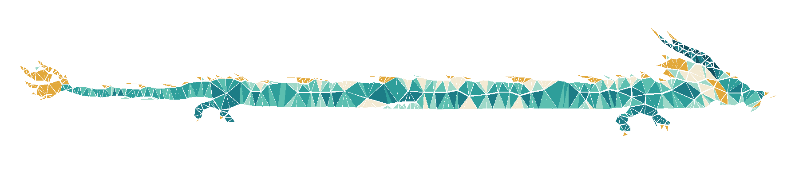
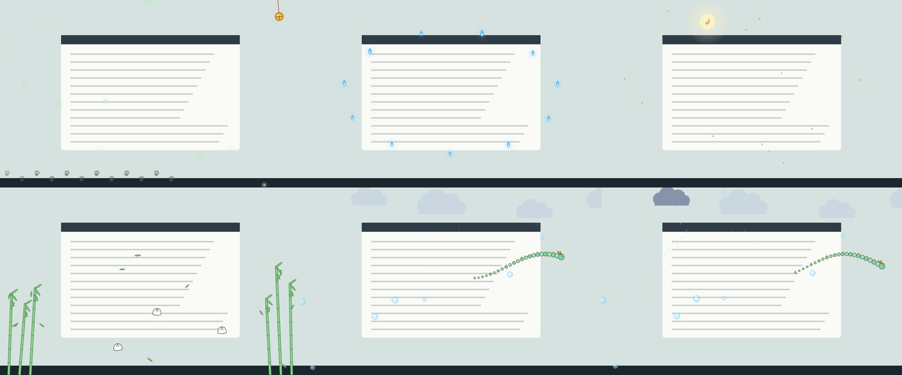
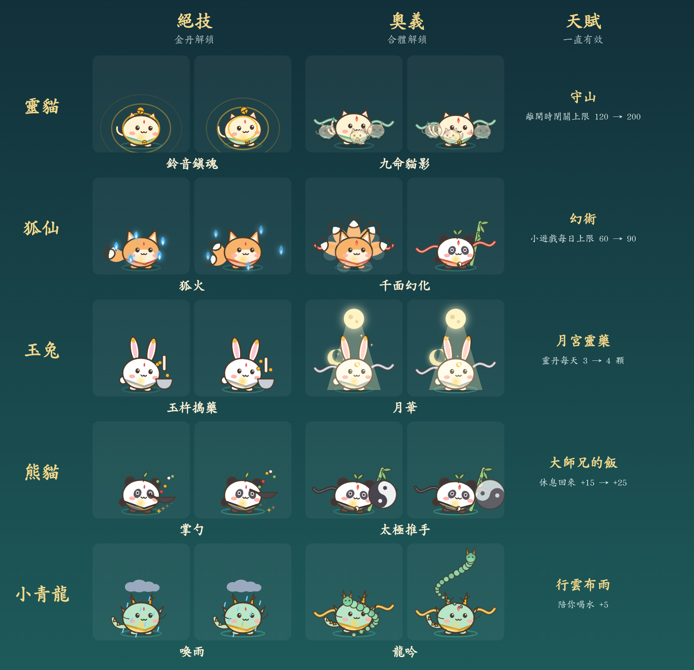
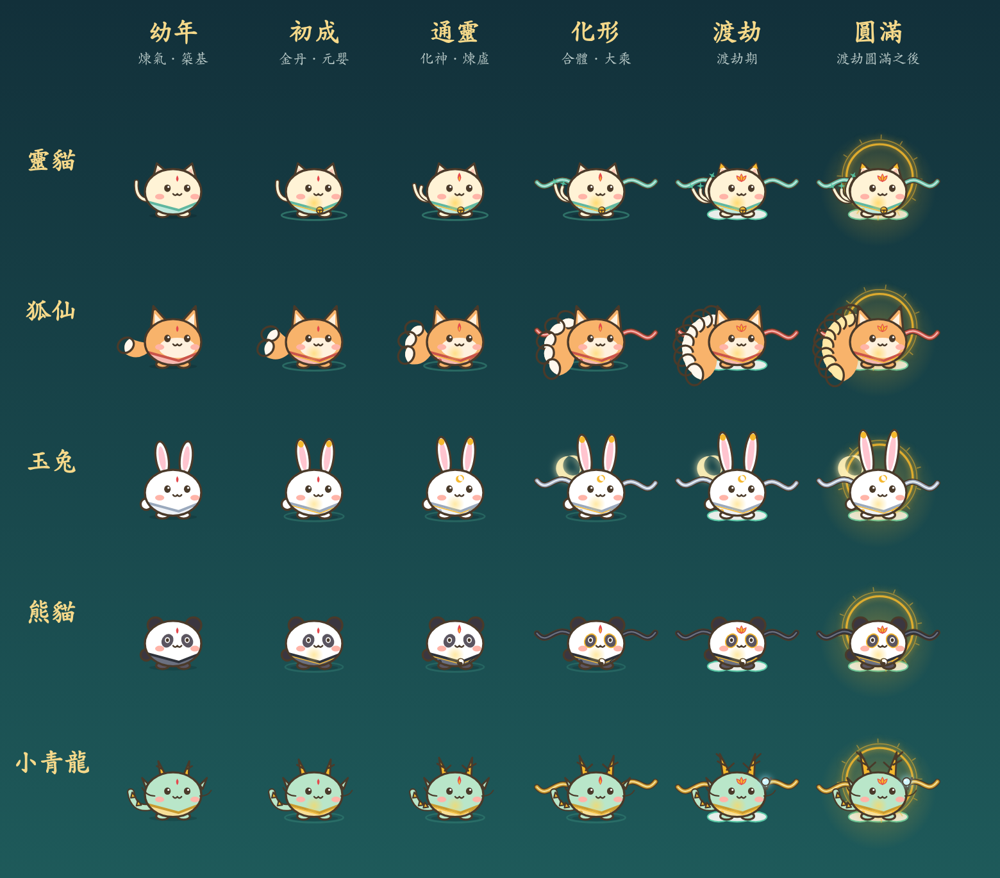

# 桌面靈寵（仙俠主題桌面寵物）

**介紹影片**：[trailer.mp4](trailer.mp4)（精簡版約 1 分 33 秒：只挑重點——故事序章、桌面互動、五位同門、五個奧義、心魔與回家，每段都完整演完；原始檔在 `build/trailer/`。先 `python3 music.py` 產生配樂，再 `node render.js edl cut.json ../../trailer.mp4` 照剪輯表 `cut.json` 剪出成片；想改剪哪幾段，只要改 `cut.json`）

一隻穿道袍的小靈獸，停在螢幕桌面最上層陪你工作。透明視窗、角色以外的區域滑鼠可穿透，不會擋到底下的軟體。

## 取得程式

每次 `desktop-pet/` 有更新，GitHub Actions 會自動打包：

1. 到本儲存庫的 **Actions → 桌面靈寵打包**，點最新一次成功的執行紀錄。
2. 在頁面最下方 **Artifacts** 下載 `DeskPet-Windows`（或 `DeskPet-macOS`）。
3. 解壓縮後：
   - **Windows（建議用安裝版）**：雙擊 `DeskPet-Setup-1.0.0.exe`，照畫面步驟按下一步即可。裝好後桌面和開始功能表都會有「桌面靈寵」捷徑。
     - 程式沒有數位簽章，Windows 可能跳出藍色的 SmartScreen 警告，按「其他資訊 → 仍要執行」就能繼續。
     - 不想安裝的話，同一個壓縮檔裡還有免安裝版 `DeskPet-1.0.0-win.exe`，直接雙擊就能用（不會建立捷徑，也不會出現在「應用程式」清單）。
   - **macOS**：開啟 dmg 拖進「應用程式」。程式未簽章，第一次需在終端機執行 `xattr -cr /Applications/DeskPet.app` 後再開啟。

自己從原始碼執行：`npm install` 後 `npm start`。

## 解除安裝

安裝版有三種方式，選一種就好：

1. 在靈寵身上按右鍵，選「解除安裝…」，確認後就會開始移除。
2. Windows **設定 → 應用程式**，找到「桌面靈寵」，按「解除安裝」。
3. 從**開始功能表**找到「桌面靈寵」，按右鍵選「解除安裝」。

解除安裝會一併取消「開機自動啟動」。修為與設定會保留在 `%APPDATA%\desk-pet`，重新安裝後會接著用；想完全清除，把這個資料夾刪掉即可（在檔案總管網址列輸入 `%APPDATA%\desk-pet` 就能打開）。

免安裝版不用解除安裝，結束程式後把 exe 刪掉就好。

## 互動

| 動作 | 反應 |
| --- | --- |
| 點一下 | 摸頭，冒出靈氣光點，修為 +2 |
| 2.5 秒內連點 5 下 | 道心不穩，暈眩 |
| 按住拖曳 | 抓起來，放開會掉落；甩出去會撞牆反彈，摔太重會「走火入魔」。表情看你怎麼抓：剛抓起來嚇一跳、甩很快是驚嚇、左右晃會緊閉眼 ＞＜、慢慢帶著走是星星眼、拿著不動會瞇眼享受 |
| 在身上滾滾輪 | 御劍飛行：飛在游標旁邊追著它跑十秒，再滾一次就延長；時間到了原地降落。飛行中被點也不會停 |
| 右鍵（或系統匣圖示） | 選單：餵靈丹、打坐修煉、御劍飛行、來追我、躲貓貓、吟詩一首、寫傳音符、今日三件事、勉勵我一句、大小、角色、裝扮、健康提醒（喝水、護眼、起身活動）、說話、置頂、開機自動啟動、解除安裝（安裝版才有）、結束 |
| 游標移動 | 眼睛會跟著游標；偶爾會主動追游標 |
| 閒著時偶爾 | 吟一首唐詩、宋詞或元曲，一句一句唸，最後報出處（右鍵「吟詩一首」可以隨時聽） |
| 快速左右甩滑鼠 | 牠以為你在發劍氣：有時跟著原地轉圈，有時嚇得躲到螢幕邊 |
| 走到螢幕邊緣 | 有時施展壁虎遊牆功：貼著牆爬上去、在頂端倒掛，再翻個筋斗落地 |
| 右鍵「寫傳音符…」 | 打一句話、選時間（5／15／30 分鐘後、1 小時後或指定時間），時間到牠叼著黃符跳到游標旁一句一句念給你聽，電腦也會跳通知。可以當開會、交圖提醒 |
| 右鍵「今日三件事」 | 寫下今天最重要的三件事，卷軸會留在桌面角落（可拖曳）。做完點一下蓋「成」字印、修為 +10；三件都完成放煙火、修為 +30。隔天自動換新的一天 |
| 早上第一次用電腦 | 每天第一次用電腦時（剛開機，或電腦整晚沒關、隔天回來動滑鼠時），牠跟你打招呼，問「今天最重要的三件事是什麼？」，順手打開今日三件事卷軸；如果已經寫過，就提醒你記得做 |
| 每用電腦一小時 | 牠拿出酒葫蘆喝一口，說「道友也喝口水吧」，再念一句和水有關的詩。只算你真的在用電腦的時間，離開座位不算 |
| 每用電腦 20 分鐘 | 牠望向遠方（有一道視線指向遠山），說「看看 6 公尺外、遠眺 20 秒」，再念一句遠眺的詩；20 秒後說「眼睛舒服多了吧」 |
| 右鍵「勉勵我一句」 | 隨時聽一句勵志古詩詞或仙俠口吻的打氣話 |
| 坐太久 | 你連續用電腦 50 分鐘（右鍵「健康提醒」可改 30／45／60 分鐘或關閉），牠打一套太極提醒你起來動一動；滑鼠鍵盤停三分鐘以上就算休息過，回來時修為 +10。沒起來的話十分鐘後再提醒 |
| 打坐中被點 | 嚇一跳：「修煉被打斷了！」 |

## 玩法與互動（2026-11-19 新增）

| 動作 | 反應 |
| --- | --- |
| 右鍵「求一卦（每日一次）」 | 牠搖三枚銅錢起卦，頭上出現卦象（六爻），一句一句說：第幾卦、卦名、卦辭、白話解卦和今天的建議。一天一卦，再求會說「天機不可多問」並重念今天的卦 |
| 點不同部位 | 耳朵、額頭、尾巴、肚子（翻身給你摸）、腳各有反應；每個角色藏一個笑穴（靈貓下巴、狐仙尾巴尖、玉兔耳朵尖、熊貓肚臍、小青龍龍角），點到會笑到打滾 |
| 快速連點五下 | **比法術**：游標變黃符，每點一下從游標射出一道符（雷、火、冰輪流）炸在牠身上 |
| 游標在牠身上來回揮 | **比劍**：游標變劍，揮過的地方留下劍痕和火花，牠舉劍格擋 |
| 比法術／比劍時 | 十秒一場。上方有連擊數、進度條和你的三顆心；牠會在大半個螢幕上輕功奔跑（腳下踏雲）、御劍乘風（身後殘影與氣流）、縮地成寸瞬移，還會喊出招式名，要追著打。連擊、暴擊、十連擊里程碑、畫面震動和越來越高的音效都是回饋；比劍時手上的配件會換成劍，比法術時換成黃符。牠每隔兩秒左右亮紅光準備反擊，0.8 秒內出手就「擋！」，沒擋到扣一顆心。結束時說「法術 18・格擋 3・修為 +7」。右鍵「鬥法音效」可關掉聲音 |
| 右鍵「三仙歸洞」 | 猜杯小遊戲：靈珠藏在三個茶杯裡，洗一洗讓你猜，境界越高洗越快 |
| 右鍵「比劍」 | 擂台模式：牠從上、中、下路出招，點對位置格擋，抓破綻連擊 |
| 被丟出去 | 輕放、撞牆、撞到天花板、丟得很高（會御劍時半空召出飛劍接住自己）、飛很久、摔太重（走火入魔）反應都不同 |
| 按 Win+L 鎖定螢幕 | 牠立刻打坐；回來時說「道友下山 42 分鐘，歸來了」 |
| 太晚還在用電腦 | 宵禁燈籠：過了設定時間（預設 23 點，右鍵可改或關），牠挑著紅燈籠，每半小時打個哈欠、說今天用了幾小時，溫和勸你收工 |
| 偶爾 | **心魔來襲**：旁邊冒出一隻紅眼黑影，說拖延的話（「圖明天再改／業主不會發現」）。點三下打散牠（化神以後雙擊打兩格），修為 +15 |
| 很少見 | **天降祥瑞**：金色錦鯉游過、仙鶴飛過、彩虹、流星。點到錦鯉修為 +5；點流星可以許願，右鍵「願望簿」看以前許的願 |
| 角色的故事 | 換角色時牠會自我介紹；閒著時偶爾講自己的故事，照境界一段一段解鎖（右鍵「聽牠講故事」）；召喚同門後，兩隻會聊彼此的關係 |

## 螢幕保護的小插曲

- **熊貓吃包子**：熊貓的「竹林灶火」裡冒出包子時，桌面上的熊貓會醒來跑過去，包子飛進嘴裡。
- **黑風怪**：不只螢幕保護，平時用電腦時大約每 40～90 分鐘也會來一次（每個角色都會遇到，各自要不同的東西：小魚乾、狐火、月餅、包子、龍珠；右鍵「引出黑風怪（練手）」可隨時叫出）。螢幕保護開了一分鐘左右也會出現，反派黑風怪從畫面邊溜進來偷東西（熊貓場景偷包子）。靈寵喊「何方妖孽！」跑去出招打牠，你也可以點牠幫忙；打倒了「邪不勝正！」修為 +10，太慢牠就帶著東西跑掉。之後每兩三分鐘可能再來一次。每打退一次，靈寵多說一段黑風怪的來歷（牠是心魔的爪牙、身上有師父燈油的味道……最後會變回小山妖回家）。
- **BOSS**：大約每四次遇到一次 BOSS——燈影魔將、九幽蛟魔、心魔本尊（渡劫才會遇到）。比黑風怪大、上方有大血條，會朝靈寵丟黑氣彈（點黑氣彈可以打散）；你和靈寵一起打，打倒修為 +30 並揭開一段關鍵劇情，75 秒打不完牠會撤退。右鍵「挑戰 BOSS」可隨時挑戰。
- **小青龍的龍珠**：點龍珠拿起來，青龍追著你的游標游；再點一下放開，青龍俯衝去接。
- 右上角「✕ 收起」與「不要再自動開」。

## 健康提醒

右鍵選單的「健康提醒」裡可以：

- 分別開關**喝水提醒**（每用一小時）和**護眼提醒**（每用 20 分鐘）
- 按「現在喝口水」「現在看看遠方」，馬上來一次
- 調整起身活動的間隔（30／45／60 分鐘或關閉）

三種提醒不會擠在一起，彼此至少隔 90 秒。

## 勉勵語錄

靈寵會不時說一句勉勵的話，有三種：

- 勵志古詩詞，附作者，例如「長風破浪會有時——李白」
- 和水有關的詩、遠眺的詩（喝水、護眼提醒時念）
- 仙俠口吻的打氣話，例如「修仙如修圖，一筆一劃」「心靜則圖清」

會出現在：閒聊、劃掉一件待辦、三件事都完成、休息回來、境界突破、早安打招呼的時候。想聽就按右鍵「勉勵我一句」。

## 動畫

畫面最多每秒 90 格（螢幕更新率比較低時就照螢幕的），視窗移動也是每秒 90 次平滑過渡，看起來更順。靈寵走路、飛行的速度和以前一樣。

## 角色與裝扮

右鍵選單裡選，會記住，下次啟動照舊。每種角色都可以搭配任何裝扮。

- **角色**：靈貓、狐仙（蓬鬆大尾巴）、玉兔（長耳朵）、熊貓（黑眼圈）、小青龍（龍角、龍鬚）
- **頭飾**：不戴、斗笠、道冠玉簪、書生方巾、蓮花冠、狐狸面具、花環
- **道袍顏色**：青、月白、緋紅、墨黑、紫霞、金黃
- **配件**：不帶、背劍、酒葫蘆、摺扇

舊版勾過「戴斗笠」的，更新後會自動換成頭飾「斗笠」。

## 操作方式一覽

常用的事都能直接用滑鼠做，右鍵選單留給設定和比較少用的功能。

| 動作 | 效果 |
| --- | --- |
| 點一下 | 摸牠（點不同部位反應不同） |
| 雙擊 | 出招（一開始就能用，金丹起是本命絕技） |
| 滑鼠中鍵 | 本命奧義（合體解鎖） |
| 按住半秒 | **快捷輪盤**：絕技、奧義、餵靈丹、打坐、御劍、今日三件事、寫傳音符、求一卦。點一格就用，也可以按數字鍵 1–8；點空白或按 Esc 關掉；最上面的「更多…」開完整選單 |
| 連點五下 | 比法術 |
| 在牠身上來回揮 | 比劍 |
| 滾輪 | 御劍飛行 |
| 拖曳、甩出去 | 抓起來丟 |
| 游標畫三圈 | 縮地成寸 |
| 右鍵 | 完整選單 |

## 全螢幕技能特效

技能的氣勁、月光、雨、龍影畫在一個蓋滿螢幕的透明圖層上，不會被桌寵自己的小視窗切掉。這個圖層滑鼠會穿透，不擋你工作，演完就收起來。

- 絕技約 2 秒、奧義約 4 秒：鈴音的音波盪到螢幕邊、九道貓影貼地衝過整個螢幕、狐火螺旋飛向四周、月華讓整個螢幕暗下來升起大滿月、太極越轉越大蓋過螢幕、整個螢幕下雨、青龍在螢幕上盤旋一圈飛走。
- 不想要的話，右鍵把「全螢幕技能特效」取消，就只在牠身邊演小的版本。
- 全部招式都是**幾何風格**（`fx-geo.js`），和碎片青龍同一套語言：平塗色塊、片間留縫、線框、幾何粒子。
  - 靈貓：鈴音是一圈圈裂開的八角音環＋多面金鈴；九命貓影是碎片貓拖著殘影衝刺，最後巨大貓影躍過頭頂碎成金屑。
  - 狐仙：狐火是九顆藍色多面晶焰；千面幻化是低多邊形煙裡扇開九條碎片狐尾，滿天菱形星。
  - 玉兔：搗藥噴出六面金丹、落地起六角漣漪；月華是多面月亮（月中碎片兔影）、三角月光、多邊形桂花。
  - 熊貓：掌勺是三角火舌火柱＋多面食材；太極推手是碎片太極配外圈八卦卦爻，最後卦爻四散。
  - 小青龍：喚雨是低多邊形烏雲＋三角雨絲＋六角漣漪。
  - 任意造型切碎片的工具是 `GeoFx.shardify`：先用平塗色塊畫出造型，每片三角取中心點的顏色。想退回舊畫法，把 fx.html 的 `GEO_STYLE` 改成 false。

## 小青龍的龍

奧義「龍吟」、螢幕保護「雲海聽雨」裡的龍是**會游的色塊碎片龍**：造型取自一張 AI 畫的側面低多邊形青龍，由程式切成大片三角形，每片一個平塗色，片與片之間留縫。

每片碎片都記著「在身體的哪裡、離中線多遠」，所以龍能沿著一條曲線真的扭動著游：龍頭帶路，一道波從頭傳到尾，尾巴擺得最大。

- **龍吟**：碎片在角色身邊聚合成龍，龍鑽出來，扭著身體橫越畫面中段，再往斜上方游走。
- **螢幕保護**：龍從畫面一側游到另一側。

- **配色**：`draw.js` 的 `SHARD_PALETTE`，`qingci` 青瓷（預設）、`mojin` 墨金、`cuiyu` 翠玉。
- **造型**：`loong-swim.js`，由 `build/art/dragon/make-swim.py` 從 `geo-swim-original.png` 產生（後面可接數字調碎片大小）。另一張直立盤繞的造型在 `loong-shards.js`（`make-shards.py`），目前沒用。
- 其他程式畫法（國風寫實、Q 版、水墨、金龍、幾何青龍、黑金線描等）都還在 `draw.js`；四張 AI 原圖在 `build/art/dragon/`。

## 螢幕保護

你離開一陣子（預設閒置 10 分鐘），桌面上會飄出東西來，牠自己坐下打坐。**不換畫面**：只是多了一層透明的圖層，桌面和開著的視窗照常看得到，點擊也照常穿透。

五個角色各有一套，飄的東西、怎麼動、隔一陣子發生什麼、點了有什麼反應都不一樣：

| 角色 | 場景 | 會出現什麼 | 游標靠近 | 點一下 |
| --- | --- | --- | --- | --- |
| 靈貓 | 守山夜 | 螢火蟲；角落掛著師父的鈴鐺，隔一陣子自己響一聲、盪出金色音波；螢幕下緣走過一排貓掌印 | 螢火蟲會湊過來繞著游標轉 | 點鈴鐺：馬上響一聲，螢火蟲全部亮起來 |
| 狐仙 | 狐火燈會 | 狐火排成陣：慢慢轉的大圓、左右兩列、散開，每 16 秒換一種 | 狐火一靠近就溜走（逗你） | 點到一團：全部「噗」一聲換陣（幻術） |
| 玉兔 | 月宮桂落 | 月亮慢慢從左走到右，上面有搗藥小兔的影子；桂花一直落 | 桂花被攪得繞著游標打轉 | 點月亮：灑下一陣桂花 |
| 熊貓 | 竹林灶火 | 螢幕兩側慢慢長出竹子、落竹葉；熱騰騰的包子冒著蒸氣往上飄 | 掃過竹子，竹子會搖 | 點包子：吃掉（炸成一團蒸氣） |
| 小青龍 | 雲海聽雨 | 幾朵雲飄過，雲下下著小雨，水珠往上升；隔一陣子一條小龍從左游到右 | 水珠會閃開 | 點雲：打雷閃一下，那朵雲下一陣大雨 |

共通的：

- 小東西（螢火蟲、花瓣、竹葉、水珠）點到都會炸成一圈光點，過幾秒再飄進來。
- 只有游標正好在可點的東西上時才會接住滑鼠，其他地方照樣點得到桌面。
- 你回來動滑鼠後，牠會說「道友回來了」，場景還會多演十幾秒才慢慢散掉，所以回來時玩得到。

右鍵「螢幕保護」可以改成閒置 3／5／10／20 分鐘、關閉，或「現在開始」馬上看（手動開的會先飄 45 秒）。

## 本命技能

每個角色有三項自己的技能。換角色，技能和天賦就跟著換。

| 角色 | 絕技（金丹解鎖） | 奧義（合體解鎖） | 天賦（一直有效） |
| --- | --- | --- | --- |
| 靈貓 | **鈴音鎮魂**：搖響師父的鈴鐺，音波一圈圈盪開；心魔在場時直接震散 | **九命貓影**：化出三道貓影繞身疾走 | **守山**：你離開時牠閉關的修為上限 120 → 200 |
| 狐仙 | **狐火**：五團青藍狐火繞身一圈後射出 | **千面幻化**：一陣煙換一個樣子，四位同門輪流變一遍，再變回自己 | **幻術**：切磋與小遊戲的每日修為上限 60 → 90 |
| 玉兔 | **玉杵搗藥**：拿出杵臼搗藥，搗出一顆顆小丹丸 | **月華**：頭上升起滿月，月光灑落 | **月宮靈藥**：靈丹每天 3 顆 → 4 顆 |
| 熊貓 | **掌勺**：顛勺，火光與食材齊飛 | **太極推手**：一輪黑白太極在身前轉開，往前推出 | **大師兄的飯**：起身休息回來的修為 +15 → +25 |
| 小青龍 | **喚雨**：頭上聚起一朵雲，下一陣小雨 | **龍吟**：一道青龍虛影盤旋升天 | **行雲布雨**：喝水提醒時陪你喝完，修為 +5 |

怎麼用（不必開右鍵選單）：

- **雙擊牠**：出招。一開始就能用——煉氣、築基是彈指神通；金丹起是自己的絕技；化神起絕技和四式武學（降龍十八掌等）各半。
- **滑鼠中鍵點牠**：施展奧義。
- **按住牠不放半秒**：頭上展開快捷輪盤，裡面也有絕技和奧義。
- 右鍵「本命技能」一樣可以選；還沒到境界的會變灰，寫著幾時解鎖。
- 每天第一次施展奧義，修為 +10。
- 突破到金丹、合體時，牠會說學會了什麼。修煉紀錄裡也有一格「本命技能」。

對照圖改完繪圖後可以重畫：`node build/art/skills.js`。

### 狐仙的小把戲：變裝

- 狐仙平常閒著時，偶爾會偷偷變成別的同門（約 25～45 秒，至少隔兩分鐘才變一次）。
- 但她變不像：**狐狸尾巴藏不住、睫毛也還在**。看出來了就點她一下，她會冒一陣煙現原形：「被你看穿了！」
- 沒被發現的話，玩夠了自己會變回來。施展千面幻化時變得很完美，沒有破綻。

### 睫毛

女生角色（狐仙、玉兔）有睫毛；閉眼、眨眼時睫毛跟著往下。

## 修為與境界

境界是你這段時間「好好工作、好好休息」的紀錄，大約一週修到渡劫。角色、裝扮一直都開放；傳音符、三件事、健康提醒這些工作工具也永遠不鎖。境界只解鎖功夫和特效。右鍵「修煉紀錄…」可以看進度、今天各來源拿了多少、每日上限用了多少，以及近七天的長條圖。

**修為從哪來**

| 做什麼 | 修為 | 每日上限 |
| --- | --- | --- |
| 在電腦前用（離開不算） | 每分鐘 +1 | 480（八小時）；過了宵禁時間不加 |
| 劃掉一件事 | +20；三件全成再 +60 | 三件 |
| 起身休息後回來 | +15 | |
| 護眼看完 20 秒 | +5 | |
| 每天第一次寫好三件事 | +10 | 一次 |
| 摸頭、點牠 | +1 | 30 |
| 餵靈丹 | +30 | 三顆 |
| 你離開時牠自己閉關 | 每兩分鐘 +1 | 每次離開最多 120 |
| 比法術、比劍、三仙歸洞、擂台 | 每場最多 +15 | 合計 60 |
| 打散心魔、摸到錦鯉 | +15、+5 | 隨機出現 |
| 連續修煉 | 每天第一次 +5 × 已連續天數（最多 +30） | 一次 |
| 渡劫期閃過天雷 | +20（被劈到也有 +5） | |

上限滿了照樣能用、能玩，只是不再加修為，牠會說一聲。**熬夜不會升得比較快**：專注工作一天最多算八小時，過了宵禁時間（右鍵可改或關）用電腦不加修為。

**連續修煉**：隔一到三天再開都算連續（週末不開電腦不會斷），超過三天重新算。

**九重境界**

| 境界 | 修為 | 解鎖 |
| --- | --- | --- |
| 煉氣 | 0 | 點、拖、甩、吟詩 |
| 築基 | 150 | 腳下靈氣圈、來追我 |
| 金丹 | 500 | 肚子裡的金丹微光、御劍飛行 |
| 元嬰 | 1,000 | 壁虎遊牆功、偶爾冒出半透明元嬰小分身 |
| 化神 | 1,600 | 雙擊出招：降龍十八掌、太極畫圓、金鐘罩、彈指神通 |
| 煉虛 | 2,300 | 縮地成寸：游標連畫三圈，牠消失、出現在圈的中心 |
| 合體 | 3,100 | 召喚同門：多一隻跟著你的靈寵走的同門（右鍵可選同門角色） |
| 大乘 | 4,000 | 腳踏祥雲 |
| 渡劫 | 5,000 | 天雷閃避：雷先烏雲閃光預告三秒，點牠就閃開；修到 6,000 渡劫圓滿，全身金光 |

**小境界**：每個大境界再分初期、中期、後期、巔峰四段（各佔四分之一）。到了牠會說一聲，選單和修煉紀錄的進度條上也看得到，不演天劫。

**突破**：跨過大境界門檻時演天劫，牠會宣布獲得了什麼，再念一句勵志詩詞。如果突破後還沒演就關掉程式，下次開啟會補演。選單裡還沒解鎖的會變灰，寫著「（某某解鎖）」。

**外觀進化**：角色的樣子會跟著境界長大，共六個階段。不想要的話，右鍵把「外觀隨境界進化」取消，就維持小時候的樣子。

| 階段 | 境界 | 共通 | 靈貓 | 狐仙 | 玉兔 | 熊貓 | 小青龍 |
| --- | --- | --- | --- | --- | --- | --- | --- |
| 幼年 | 煉氣、築基 | 一點硃砂 | 一條尾巴 | 一條尾巴 | 短耳朵 | | 小龍角 |
| 初成 | 金丹、元嬰 | 衣領滾金邊 | 掛上師父的鈴鐺 | 兩尾 | 耳尖染金 | 頭頂冒出一片竹葉 | 龍角長大 |
| 通靈 | 化神、煉虛 | 硃砂長成火焰紋、下襬繡雲紋 | 兩條尾巴 | 三尾 | 眉心一彎金月 | 兩片竹葉、太極佩 | 龍角分叉 |
| 化形 | 合體、大乘 | 身後兩條披帛 | 尾尖燃起靈火 | 五尾 | 身後升起彎月 | 身後長出一枝靈竹 | |
| 渡劫 | 渡劫 | 眉心金蓮印、雲紋變金 | 三條尾巴、耳尖染金 | 八尾 | | 師父的丹爐飄在身邊、眼圈鑲金 | 龍珠繞身 |
| 圓滿 | 渡劫圓滿之後 | 頭後一圈光輪 | | 九尾，尾尖轉金 | | 光輪換成黑白太極輪 | |

狐仙三尾以內都長在身側；五尾起改成在身後左右對稱張開，像屏風一樣。熊貓的丹爐就是故事裡牠那口鍋。

對照圖改完繪圖後可以重畫：`node build/art/evolution.js`。

**圓滿之後：飛升九重天**。渡劫圓滿不是終點——之後賺到的修為化為功德，每 1,500 功德飛升一重天，共九重（大約再十八天）。每飛升一重放一次煙火，身邊多一顆繞著牠轉的金星；九重天到頂後功德仍繼續累計。

舊版的修為會換算：保留原本的境界，放在新制同一境界的起點。

## 檔案

- `main.js`：視窗、位置物理、行為狀態機、修為、選單
- `note.html`、`scroll.html`、`records.html`、`ui-preload.js`：傳音符、今日三件事、修煉紀錄的小視窗
- `iching.js`：六十四卦（卦名、卦辭、白話與建議）
- `lore.js`：五個角色的故事與彼此的關係、同門對話
- `cups.html`、`duel.html`、`omen.html`、`wish.html`、`game-preload.js`：三仙歸洞、比劍擂台、天降祥瑞、流星許願
- `poems.js`：靈寵會吟的唐詩、宋詞、元曲（每句十個字以內，泡泡才放得下）
- `quotes.js`：勉勵語錄（勵志古詩詞、遠眺詩、和水有關的詩、仙俠打氣話）
- `draw.js`：角色與特效繪圖（Canvas，無外部圖檔）
- `pet.js` / `preload.js` / `pet.html`：畫面端與滑鼠事件回報
- `build/art/`：封面、圖示、安裝程式側邊圖（改完執行 `npm run art` 重畫）
